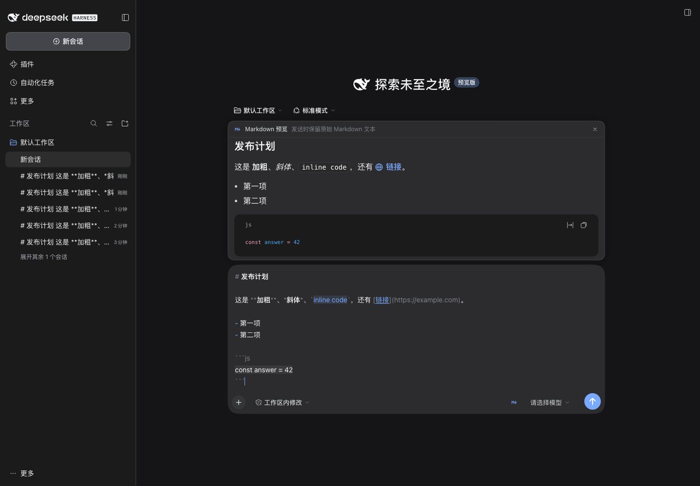
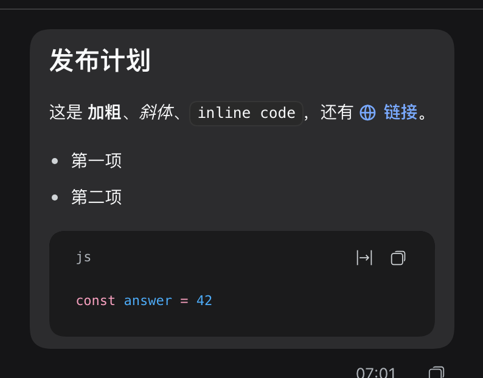

# dsh-better-markdown

**Markdown where you actually use it: the composer and your own messages.**

DeepSeek Harness renders assistant replies as Markdown, but the composer is a
plain-text editor and sent user messages come back as plain text. This plugin
closes that gap:

- **Live preview above the composer.** Type Markdown and the rendered result
  appears immediately — headings, bold/italic, inline code, lists, task lists,
  quotes, tables, fenced code with syntax highlighting, links, footnotes and
  math, all through DSH's own Markdown pipeline.
- **In-place syntax highlighting.** The composer itself dims `#`, `**`, `` ` ``
  and list markers, and paints emphasis, code, links and headings, so you can
  read the structure while typing. The draft text never changes.
- **User messages render as Markdown.** Every sent message you wrote with
  Markdown shows as Markdown in the transcript — while the copy action, the
  session log, and the text the model sees stay byte-identical.
- **One switch, remembered per browser.** The `M↓` button in the composer
  toolbar toggles the preview (`⌘⇧M` / `Ctrl+Shift+M` also works);
  the choice survives reloads. The transcript rendering follows the plugin
  configuration, not the button.



<p align="center"><em>Live rendered preview above the composer; the raw draft keeps its Markdown markers, dimmed.</em></p>



> Third-party plugin. Not an official DeepSeek / DeepSeek Harness component.

## Install

This plugin is distributed **only through GitHub** — it is not published on
npm. Requirements: **DSH 0.2.1-rc.5 or newer, below 0.3.0**, with the Web or
Desktop surface, and Node ≥ 22.

The install spec is the repository itself:

```sh
dsh plugin --profile <profile> add github:ceasarXuu/dsh-better-markdown
```

The same spec works in **Plugins → Add** in the app. A version tag pins a
release (`github:ceasarXuu/dsh-better-markdown#v0.1.0`), and a GitHub Release
tarball can be installed instead when your network setup prefers plain
artifacts:

```sh
dsh plugin --profile <profile> add https://github.com/ceasarXuu/dsh-better-markdown/releases/download/v0.1.0/ceasarxuu-dsh-better-markdown-0.1.0.tgz
```

Manual profile row (after the package is installed into the profile):

```yaml
# profiles/<profile>/cordis.patch.yml
- insert:
    - id: better-markdown
      name: '@ceasarxuu/dsh-better-markdown'
      config:
        enabled: true
        transcript: true
        composer: true
        syntax: true
        preview: true
```

Disable the bundle and the shipped plain-text behavior returns immediately.

## Switches

All switches are plain booleans on the plugin row; the browser reads them from
`GET /plugin/better-markdown/config` on page load.

| Switch | Default | What it does |
|---|---|---|
| `enabled` | `true` | Master switch for every surface. Off restores shipped behavior while the plugin stays installed. |
| `transcript` | `true` | Render sent user messages as Markdown in the conversation. |
| `composer` | `true` | Enable the composer preview and its toolbar switch. |
| `syntax` | `true` | Paint Markdown syntax inside the composer (CSS Custom Highlight API). |
| `preview` | `true` | Show the preview by default when the draft contains Markdown. |

The toolbar switch is the per-browser override: pressing it off turns the
preview off on this browser only (`localStorage` key
`better-markdown.prefs.v1`); pressing it on shows the preview for any
non-empty draft. Clearing site data returns to the host default.

## How it works

Everything runs in the browser half; the host half only publishes the
switches, so there is no network traffic beyond the same-origin config read.

- **Transcript.** DSH parses user text into runs and reference chips and
  renders each run through the keyed `conversation.user.text.node` slot. This
  plugin registers the `text` key at a lower priority than the shipped cell and
  renders the run with the platform's own `MarkdownText` component. Session
  `@`-mention chips keep their shipped renderer, and copy/quote behavior keeps
  reading the original text.
- **Preview.** A normal `conversation.input.dock` entry (the same flow the
  shipped queue and todo docks use) reads the live draft and renders it with
  the same `MarkdownText` component.
- **In-place highlighting.** A `conversation.input.right` cell provides the
  switch, and a small controller repaints `CSS.highlights` over the composer's
  text nodes. Highlights only change paint (color, background, underline,
  text-shadow) — never layout, never the draft, never IME composition.

Because rendering uses `@deepseek-ai/dsh-client-ui-primitives` from the
platform module table, user messages get exactly the GFM renderer assistant
replies use: sanitized links, highlighted code, tables, footnotes and math.
If that module is unavailable the plugin degrades to plain text instead of
breaking the page.

### Markdown in a chat message

- Single newlines stay line breaks: outside code blocks, tables and indented
  blocks, a newline becomes a CommonMark hard break before rendering, so a
  multi-line message does not collapse into one paragraph.
- Plain prose stays byte-identical to the shipped bubble; Markdown rendering
  only starts when the message contains Markdown syntax (`#`, fences, lists,
  quotes, tables, emphasis, code, links, task items).
- The queue dock's one-line preview renders the same content inline, clamped to
  a single line.
- The **session title**, sidebar rows and headers are host-generated plain text
  and are intentionally left alone.

## Limitations

- DSH's composer is a shell-owned Lexical editor. A plugin can decorate it but
  cannot turn it into a WYSIWYG surface, so "Markdown in the composer" means a
  rendered preview plus paint-only syntax highlighting — editing, caret, undo
  and Chinese IME all stay with the shipped editor.
- Highlighting needs the CSS Custom Highlight API (Chromium 105+). On a
  browser without it the plugin simply skips that layer; the preview and the
  transcript keep working.
- The transcript renderer targets DSH 0.2.x slot contracts. A future change to
  `conversation.user.text.node` or `conversation.input.dock` needs a plugin
  update; the plugin never patches DSH source.

## Development

```sh
npm test        # pure helpers: detection, hard breaks, spans, config, route
npm run check   # node --check on every shipped source
```

`dev/` contains a dependency-free Chrome DevTools Protocol harness and a live
verification script. Point a throwaway DSH home at this checkout, boot
`dsh web` on a non-desktop port, then:

```sh
node dev/verify.mjs   # 19 live checks + screenshots into docs/
```

The dev home, the server log, and the harness never touch the real `~/.dsh`
or the desktop app.

## License

MIT © ceasarXuu
