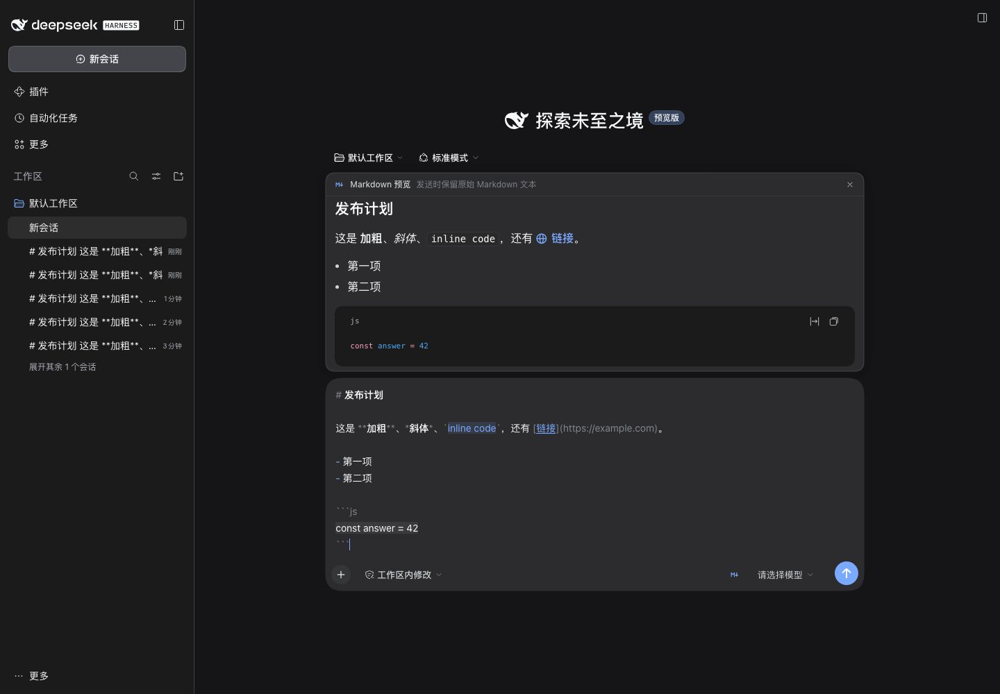
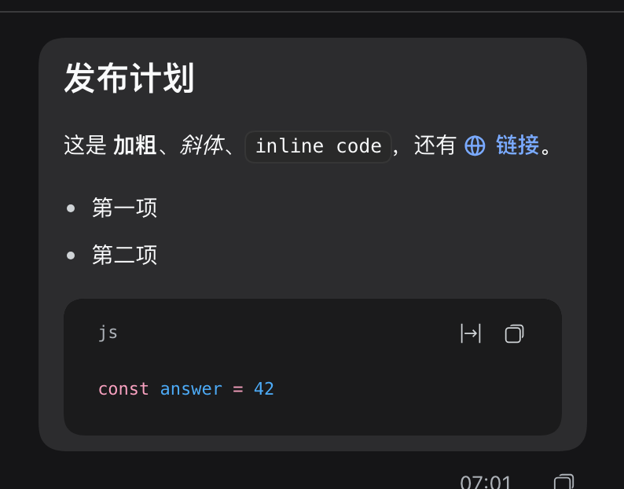

# dsh-better-markdown

**把 Markdown 放回它真正该出现的地方：输入框和你自己发出的消息。**

DeepSeek Harness 会把助手回复渲染成 Markdown，但输入框是纯文本编辑器，已发送的用户消息也会退回纯文本。
这个插件补上这一段：

- **输入框上方的实时预览。** 输入 Markdown，排版结果立刻出现——标题、加粗/斜体、行内代码、列表、
  任务列表、引用、表格、带语法高亮的代码块、链接、脚注和数学公式，全部走 DSH 自己的 Markdown 渲染管线。
- **输入框内的语法高亮。** 输入框本身会把 `#`、`**`、反引号和列表符号弱化，并给强调、代码、链接、
  标题着色，边写边能看清结构；草稿文本一个字符都不会被改动。
- **用户消息按 Markdown 渲染。** 你在对话里发出的 Markdown 消息会以 Markdown 形式展示，
  而复制动作、会话日志、模型实际读到的文本仍然保持原文不变。
- **一个开关，按浏览器记住。** 输入框工具条上的 `M↓` 按钮随时开关预览
  （`⌘⇧M` / `Ctrl+Shift+M` 同样有效）；刷新后仍然生效。对话流渲染跟随插件配置，不受按钮影响。



<p align="center"><em>输入框上方的实时渲染预览；草稿原文保留 Markdown 标记，标记被弱化。</em></p>



> 第三方插件，不是 DeepSeek / DeepSeek Harness 官方组件。

## 安装

本插件**只在 GitHub 发布**，没有发布到 npm。要求 **DSH 0.2.1-rc.5 及以上、低于 0.3.0**，
带 Web 或 Desktop 界面，Node ≥ 22。

安装规格就是仓库本身：

```sh
dsh plugin --profile <profile> add github:ceasarXuu/dsh-better-markdown
```

在应用的 **插件 → 添加** 里填写同样的规格即可。可以用版本标签固定到某个发布
（`github:ceasarXuu/dsh-better-markdown#v0.1.0`）；如果网络环境更适合直接下载产物，
也可以安装 GitHub Release 里的 tarball：

```sh
dsh plugin --profile <profile> add https://github.com/ceasarXuu/dsh-better-markdown/releases/download/v0.1.0/ceasarxuu-dsh-better-markdown-0.1.0.tgz
```

包安装进 profile 后，也可以手写配置行：

```yaml
# profiles/<profile>/cordis.patch.yml
- insert:
    - id: better-markdown
      name: '@ceasarxuu/dsh-better-markdown'
      config:
        enabled: true
        transcript: true
        composer: true
        syntax: true
        preview: true
```

停用这个 bundle，原生纯文本行为会立刻恢复。

## 开关

所有开关都是插件行上的布尔值；浏览器在页面加载时从
`GET /plugin/better-markdown/config` 读取。

| 开关 | 默认 | 作用 |
|---|---|---|
| `enabled` | `true` | 所有界面的总开关。关闭后恢复原生行为，插件仍保持安装。 |
| `transcript` | `true` | 让已发送的用户消息在对话流中按 Markdown 渲染。 |
| `composer` | `true` | 启用输入框预览和它的工具条开关。 |
| `syntax` | `true` | 在输入框内绘制 Markdown 语法高亮（CSS Custom Highlight API）。 |
| `preview` | `true` | 草稿含 Markdown 时默认显示预览。 |

工具条开关是**按浏览器**的本地覆盖：按掉后只影响当前浏览器
（`localStorage` 键 `better-markdown.prefs.v1`）；按亮后任何非空草稿都会显示预览。
清除站点数据即回到插件配置的默认值。

## 工作原理

功能全部在浏览器半边完成；宿主半边只负责发布开关，因此除了同源读取配置之外没有任何网络请求。

- **对话流。** DSH 会把用户文本解析成文本片段与引用 chip，再按 keyed 槽
  `conversation.user.text.node` 渲染每个片段。本插件以更低优先级注册 `text` 键，
  用平台自带的 `MarkdownText` 组件渲染该片段。会话 `@` 提及 chip 保持原生渲染；
  复制、引用等操作读取的仍是原始文本。
- **预览。** 一个普通的 `conversation.input.dock` 槽条目（与原生队列、待办 dock 同一条流），
  读取实时草稿并用同一个 `MarkdownText` 组件渲染。
- **输入框内高亮。** `conversation.input.right` 槽提供开关；一个小控制器在输入框文本节点上
  重绘 `CSS.highlights`。高亮只改变绘制（颜色、背景、下划线、文字阴影），
  不改变布局、不改变草稿、不影响输入法合成。

渲染复用平台模块表里的 `@deepseek-ai/dsh-client-ui-primitives`，所以用户消息与助手回复走完全相同的
GFM 渲染器：链接经过安全过滤、代码带高亮、支持表格、脚注与数学公式。如果该模块不可用，
插件会降级为纯文本，而不是让页面报错。

### 聊天消息里的 Markdown

- 单个换行仍然保留为换行：在代码块、表格、缩进块之外，渲染前会把换行补成 CommonMark 硬换行，
  多行消息不会塌成一段。
- 纯文字消息与原生气泡逐字节一致；只有出现 Markdown 语法（`#`、围栏、列表、引用、表格、强调、
  行内代码、链接、任务项）时才按 Markdown 渲染。
- 队列 dock 的单行预览会把同样的内容内联展示，并限制为一行。
- **会话标题**、侧边栏行和页头是宿主生成的纯文本，刻意不做改动。

## 已知限制

- DSH 的输入框是 shell 持有的 Lexical 编辑器。插件可以装饰它，但不能把它变成所见即所得编辑器；
  所以“输入框里的 Markdown”是**实时预览 + 只改绘制的语法高亮**——编辑、光标、撤销、中文输入法
  仍由原生编辑器负责。
- 语法高亮依赖 CSS Custom Highlight API（Chromium 105+）；不支持时这一层自动跳过，
  预览与对话流渲染不受影响。
- 对话流渲染依赖 DSH 0.2.x 的槽契约。未来若 `conversation.user.text.node` 或
  `conversation.input.dock` 变更，需要更新插件；插件不会修改 DSH 源码。

## 开发

```sh
npm test        # 纯函数：语法探测、硬换行、高亮片段、配置、路由
npm run check   # 对所有发布源码执行 node --check
```

`dev/` 里是无依赖的 Chrome DevTools Protocol 测试工具和实机验证脚本。准备一个指向本仓库的临时 DSH home，
在非桌面端口启动 `dsh web`，然后：

```sh
node dev/verify.mjs   # 17 项实机检查 + 截图写入 docs/
```

临时 home、服务日志和测试工具都不会碰真实的 `~/.dsh` 或桌面应用。

## 许可证

MIT © ceasarXuu
